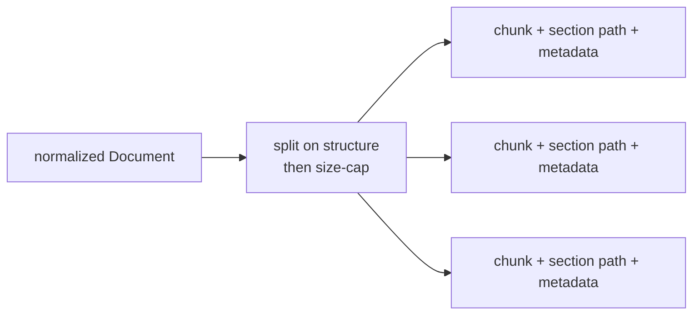

# Chunking

Splitting extracted documents into **retrievable units**. The chunk — not the document —
is what gets embedded, searched, and returned, so chunk boundaries decide what the LLM
can and cannot see together at answer time.

Part of the [harvester pipeline](harvest.md): **[extract](extraction.md) → _chunk_ → [embed](embedding.md)**.

## Why it matters: the size tradeoff

- **Too big** — the embedding averages over many ideas, retrieval gets fuzzy, and each hit
  burns prompt tokens.
- **Too small** — a chunk loses the context that made it meaningful ("it" with no
  antecedent), and one answer gets scattered across many fragments.

The goal is chunks that are **self-contained** (readable on their own) yet **focused** (one
idea), sized to the embedding model's sweet spot.

## Strategies

| Strategy | How it splits | Best for |
|---|---|---|
| **Fixed-size** | N tokens/chars with overlap | baseline, format-blind |
| **Recursive / structure-aware** | on natural boundaries (headings → paragraphs → sentences), then size-cap | general documents |
| **Semantic** | where embedding similarity between adjacent sentences drops | prose with topic shifts |
| **Layout / section-aware** | by document sections; keep tables & figures intact | **research papers** |
| **Small-to-big / parent-document** | embed small chunks, retrieve with surrounding parent context | precision + context together |

## Parameters

- **Chunk size** — tie to the embedding model's max input and desired retrieval
  granularity (see [embedding](embedding.md)).
- **Overlap** — a small window (e.g. 10–15%) so a fact split across a boundary survives.
- **Breadcrumbs** — prepend the section path (`Title > Section > Subsection`) to each
  chunk so an isolated paragraph still carries its context into the embedding.

## Research papers

- Chunk **by GROBID section**, not by fixed token count.
- Keep **tables and figure captions intact** as their own chunks — never split a table.
- Prepend the **section path** to every chunk.
- Treat the **abstract as its own high-value chunk** — it's often the best single hit.

## Carry metadata down

Every chunk inherits the document's identifiers — DOI, title, authors, year, venue,
section, page (or video timestamp). This is what lets retrieval **cite sources** and
**filter** ("only 2023+", "only this venue"), and it maps onto the DynamoDB catalog.

## Tools

LangChain / LlamaIndex text splitters, `semantic-chunkers`, or a custom splitter driven by
the extractor's structural elements. Since extraction already emits ordered elements, a
thin custom section-aware splitter is often better than a generic one.

## Notes

- Chunking is **cheap to redo** — *if* extraction persisted parsed artifacts to S3, you can
  re-chunk the whole corpus without re-fetching or re-parsing. Iterate on strategy freely.
- Changing chunking means re-embedding (the chunk boundaries changed), so pair chunking
  experiments with [embedding](embedding.md) reruns.
- Overview: [harvester pipeline](harvest.md).
