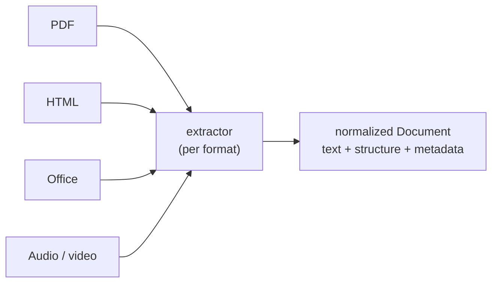

# Extraction (parsing)

Turning fetched **bytes into clean text, structure, and per-document metadata**. This
is the quality ceiling of the whole RAG pipeline — no embedding model or chunking
strategy can recover information that extraction dropped or garbled.

Part of the [harvester pipeline](harvest.md): **fetch → _extract_ → [chunk](chunking.md) → [embed](embedding.md)**.

## The real problem: structure, not characters

Pulling raw characters out of a file is the easy part; preserving **reading order and
structure** is the hard part. A two-column paper read left-to-right becomes nonsense; a
table flattened to a line of numbers loses its meaning; a lost heading means downstream
chunking can't split on sections. Because chunking depends on knowing where a section
starts and where a table sits, an extractor that produces character soup caps retrieval
quality no matter what follows.

## Tools by media type

### PDFs / research papers (the hard part)

| Tool | What it's for |
|---|---|
| **GROBID** | *Purpose-built for scholarly PDFs.* Structured TEI XML: title, authors, abstract, **sections**, parsed references. Best-in-class for papers. |
| **Nougat** (Meta) | ML model, PDF → markdown; strong on **equations/math**. GPU-accelerated. |
| **Marker** / **MinerU** / **Docling** (IBM) | PDF → markdown, structure- and table-aware. Marker is fast; Docling handles tables well. |
| **PyMuPDF / pdfplumber / pypdf** | Lower-level text extraction when ML parsing is overkill. |
| **Tesseract / AWS Textract** | OCR fallback for *scanned* (image-only) PDFs. |

Watch for: two-column **reading order**, **equations** (choose an ML parser if math
matters), **tables** (Docling/Textract preserve cells best), and **references** (GROBID
parses them into structured citations).

### Websites / blogs (HTML)

- **Crawl**: Scrapy, or **Crawl4AI** (LLM-oriented); **Playwright** for JS-heavy sites.
- **Extract**: **trafilatura** for boilerplate removal (strips nav/ads far better than
  raw BeautifulSoup); `readability`, `newspaper3k` as alternatives.

### Word / Office documents

`python-docx`, or **Apache Tika** (JVM server, ~1000 formats), or headless LibreOffice to
convert → PDF/text first.

### Audio / video

`yt-dlp` to download → `ffmpeg` to extract audio → **Whisper / faster-whisper / WhisperX**
to transcribe. Output is a transcript **with timestamps** — keep them; they become chunk
metadata for "jump to the moment" citations.

### Swiss-army (many formats at once)

- **unstructured.io** — `partition()` auto-detects format across PDFs, docs, HTML, email.
- **Apache Tika** — JVM server, text + metadata from almost anything.
- **LlamaIndex / LangChain document loaders** — hundreds of connectors; good glue, but
  wrap them behind your own interface because they churn.

## Born-digital vs scanned

Detect the format from the bytes (magic/mime), then for PDFs check whether a **text layer**
exists. Born-digital → parse directly. Image-only (scanned) → route through OCR. Getting
this branch wrong is a common cause of silently empty extractions.

## Output contract: one normalized Document

Have every extractor emit a **single internal schema** so chunking stays format-agnostic:

| Field | Purpose |
|---|---|
| `text` | full clean text |
| `elements` | ordered structural units (heading, paragraph, table, figure caption) |
| `metadata` | source id (DOI/URL), title, authors, year, page/timestamp map |
| `source_hash` | content hash for idempotency |

Downstream stages only ever see this schema — swapping GROBID for Docling changes nothing
for chunking or embedding.

## Failure handling

OCR fallback for empty text layers, accept **partial** extraction (a bad table shouldn't
drop the whole paper), and **quarantine** unparseable inputs to a dead-letter location
with the error recorded in the catalog rather than failing the whole batch.

## Persist parsed artifacts

Write the normalized Document to S3 keyed by `source_hash`. Re-chunking or re-embedding
with a better model then never re-fetches or re-parses the source — extraction is the
most expensive stage to repeat, so do it once.

## Notes

- Extraction quality is worth measuring — spot-check parsed output against source PDFs;
  regressions here are invisible until retrieval quality quietly drops.
- Next stage: [chunking](chunking.md). Overview: [harvester pipeline](harvest.md).
