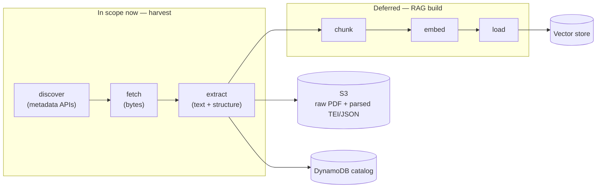
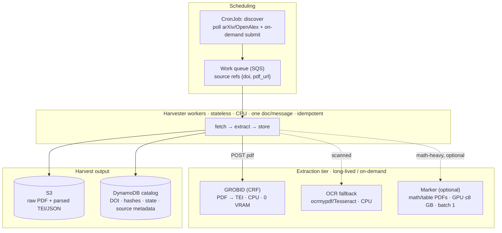
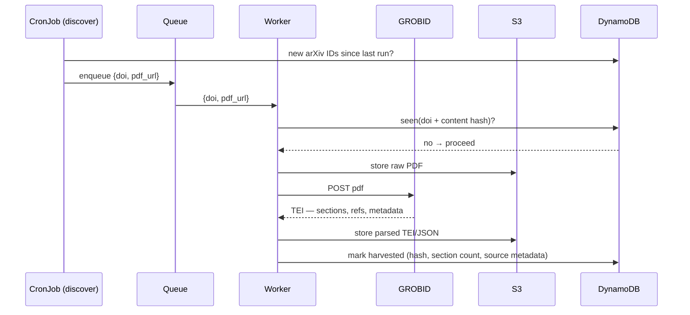

# RAG harvesting / ingestion architecture

A design reference for the **harvester** — the ingest half of a RAG pipeline. The full
pipeline discovers source documents, extracts clean text and structure, chunks and
enriches them, embeds them, and loads them into a vector store plus a metadata catalog.

**Current build scope is _harvest only_** — discover → fetch → extract, producing a
structured, deduplicated document store. Everything after extraction (chunk / embed /
load) is designed but **deferred**; see [Deferred: later phases](#deferred-later-phases).

The design is also **constrained to the real hardware**: a single node with an **8 GB
VRAM** GPU (see [Hardware reality](#hardware-reality-8-gb-vram)). It is a design reference,
**not** an implementation in this repo — see [Where it belongs](#where-it-belongs) for the
scope boundary (harvester = workload runtime code; this repo = the platform it runs on).

## What a harvester is

Retrieval-Augmented Generation has two halves. The **retrieval** half (embed the query,
search the vector store, stuff the results into the LLM prompt) is what people usually
mean by "RAG" — but it is worthless without an **ingest** half continuously feeding it
good, well-structured, well-labelled content. The harvester is that ingest half: a batch
pipeline of discrete stages. Only the shaded front (**discover → fetch → extract**) is in
scope now.



Each stage has one job and a clean interface (bytes in / documents out), so stages can be
tested, swapped, and scaled independently. Treat it as a **batch job**, not a
request/response service — harvesting is bursty, so a k8s `Job`/`CronJob` or an
SQS-driven worker fits far better than a long-lived Deployment.

## Current scope: harvest only

The deliverable for this phase is a **structured, deduplicated paper archive** — not a
RAG index yet, but valuable on its own and the exact input the later stages need:

- **Discover** new papers from metadata APIs.
- **Fetch** the PDFs; store raw bytes in S3, keyed by content hash.
- **Extract** structured text + metadata (GROBID → TEI); store parsed output in S3 and a
  catalog row in DynamoDB.
- **Stop.** No chunking, embedding, vector store, or loading yet.

Why stop here: the harvest output is stable and reusable. You can re-chunk and re-embed it
with any model later without ever re-fetching or re-parsing — extraction is the expensive,
rate-limited, network-bound part, so getting a clean corpus banked first is the right first
milestone.

## Generic by interface, papers-first by implementation

The vast majority of sources are research papers, so build **one** connector well rather
than a rigid papers-only script or four half-built connectors. The pipeline splits so that
only the front varies by source type:

```
SourceConnector (the plugin interface)
  discover(since)  -> [SourceRef]     # arXiv/OpenAlex query, RSS, or a submitted DOI
  fetch(ref)       -> bytes           # pull the PDF
  extract(raw)     -> Document         # → normalized Document (see extraction.md contract)

PaperConnector implements the three methods. Adding HTML/video/docs later = one more
connector; the storage + catalog + dedup spine is written once and untouched.
```

## Hardware reality (8 GB VRAM)

Single node, one GPU, **8 GB VRAM**. The load-bearing fact: **harvest is almost entirely
CPU/IO work**, so the GPU sits mostly idle in this phase. Plan around what actually fits.

| Component | Where it runs | VRAM | Verdict on 8 GB |
|---|---|---|---|
| Discovery / fetch / catalog | CPU + network | — | Trivial |
| **GROBID** (CRF engine) | CPU (Java service) | **0** | ✅ Primary workhorse — see below |
| OCR — Tesseract / `ocrmypdf` | CPU | 0 | ✅ Scanned-PDF fallback |
| **Marker** (Surya models) | GPU | ~3–4 GB | ⚠️ Optional. Fits at **batch 1**, one worker; slower |
| Docling | CPU or modest GPU | ~2–4 GB | ⚠️ Alternative to Marker; fits |
| Nougat (math PDFs) | GPU | ~6–8 GB | ⚠️ Marginal + slow on 8 GB — use sparingly or skip |
| MinerU | GPU | ~8 GB+ | ❌ Too tight for 8 GB comfortably |
| GROBID **deep-learning** (SciBERT/DeLFT) | GPU | large | ❌ Not needed; skip |

Practical rule: **run everything on CPU (GROBID + OCR) and keep the GPU free.** Only reach
for a GPU parser (Marker/Docling, batch 1) on the minority of PDFs where equations or
complex tables actually matter — and even then it's optional for a first harvest.

## Extraction: will GROBID work?

**Yes — and it doesn't use your GPU at all.**

- GROBID's default engine is **CRF (Wapiti), CPU-only**. It runs as a long-lived REST
  service (`grobid/grobid`, ~port 8070); you `POST` a PDF to
  `/api/processFulltextDocument` and get back **TEI XML**: title, authors, abstract,
  affiliations, **sections**, and parsed **references**. It wants ~4 GB of *system RAM*,
  not VRAM.
- It is **purpose-built for born-digital scholarly PDFs** — i.e. the vast majority of
  arXiv/OpenAlex papers. This is the single best structure/metadata extractor for papers.
- **Weak spots:** complex equations (extracted as text, not LaTeX) and intricate table
  layouts. If those matter for a given paper, route just that PDF through **Marker**
  (GPU, batch 1) as an optional upgrade. You do **not** need the deep-learning GROBID
  variant to get good results.
- **Scanned/image-only PDFs** have no text layer → run **`ocrmypdf`/Tesseract** (CPU)
  first to add one, then feed to GROBID.

So the extraction tier on this hardware is: **GROBID (CPU) as primary, OCR (CPU) as the
scanned fallback, Marker/Docling (GPU, batch 1) as an optional quality path.** See
[extraction.md](extraction.md) for the fuller tool landscape.

## Component architecture (harvest only)

Heavy work runs as a long-lived **GROBID service**; the harvester workers are thin,
stateless, CPU clients that call it and write results. No embedding server and no vector
store in this phase.



## One paper, end to end



Each document is **independent and idempotent** (keyed on DOI + content hash), so the batch
is embarrassingly parallel and safe to retry — add workers to go faster, and a re-run skips
anything already harvested.

## Discovery & fetch

- **Discover via metadata APIs, not scraping.** They return clean metadata plus legal PDF
  links — don't crawl publisher sites.
- **Capture rich metadata now** — DOI, title, authors, year, venue. It costs nothing at
  discovery time and is what later lets the RAG cite and filter. Store it in the catalog.
- **Fetch** the bytes and land the **raw PDF in S3**, keyed by content hash. Respect API
  rate limits (arXiv especially).
- **Dedup** on DOI + content hash so an unchanged paper is never re-fetched or re-parsed —
  aligns with the existing run-stamped lifecycle.

### Source APIs

All free. The goal for each is **search → downloadable PDF URL**, so the table notes which
field yields the PDF. Almost every service wants your email (`mailto=` / `email=` / API
key) — it's the fast lane, so set a real address from day one.

| Source | Base URL | Docs | PDF via | Auth / limits |
|---|---|---|---|---|
| **OpenAlex** | `https://api.openalex.org` | [docs](https://docs.openalex.org) | `best_oa_location.pdf_url` | none; `mailto=` polite pool; 100k/day |
| **arXiv** | `http://export.arxiv.org/api/query` | [user manual](https://info.arxiv.org/help/api/user-manual.html) | `<link title="pdf">` or `arxiv.org/pdf/{id}` | none; **≤1 req / 3 s**; returns **Atom XML** |
| **Unpaywall** | `https://api.unpaywall.org/v2` | [docs](https://unpaywall.org/products/api) | `best_oa_location.url_for_pdf` | `email=` **required**; 100k/day |
| **Semantic Scholar** | `https://api.semanticscholar.org/graph/v1` | [API docs](https://api.semanticscholar.org/api-docs/) | `openAccessPdf.url` | key recommended; shared pool is throttled |
| **Crossref** | `https://api.crossref.org` | [docs](https://www.crossref.org/documentation/retrieve-metadata/rest-api/) | — (metadata/refs only) | none; `mailto=` polite pool |
| **PubMed** (E-utilities) | `https://eutils.ncbi.nlm.nih.gov/entrez/eutils/` | [docs](https://www.ncbi.nlm.nih.gov/books/NBK25501/) | — (abstracts only) | 3/s, or 10/s with `api_key=` |
| **Europe PMC** | `https://www.ebi.ac.uk/europepmc/webservices/rest` | [docs](https://europepmc.org/RestfulWebService) | `fullTextXML` for OA subset | none |

Example calls:

```bash
# OpenAlex — search, filter by date, join the polite pool
curl 'https://api.openalex.org/works?search=retrieval%20augmented%20generation&filter=from_publication_date:2024-01-01&per-page=25&mailto=you@example.com'
# OpenAlex — single work by DOI
curl 'https://api.openalex.org/works/https://doi.org/10.7717/peerj.4375?mailto=you@example.com'

# arXiv — category feed + keyword, newest first (NOTE: Atom XML, not JSON)
curl 'http://export.arxiv.org/api/query?search_query=cat:cs.LG+AND+all:rag&start=0&max_results=20&sortBy=submittedDate&sortOrder=descending'

# Unpaywall — resolve a DOI to a legal OA PDF
curl 'https://api.unpaywall.org/v2/10.1038/nature12373?email=you@example.com'

# Semantic Scholar — search; `fields` controls the payload
curl 'https://api.semanticscholar.org/graph/v1/paper/search?query=vector%20database&fields=title,year,abstract,openAccessPdf,externalIds'

# Crossref — metadata + references (does NOT host PDFs; resolve via Unpaywall)
curl 'https://api.crossref.org/works?query=diffusion+models&filter=type:journal-article&rows=20&mailto=you@example.com'
```

**Recommended flow for a paper-heavy (arXiv-dominant) corpus:**

1. **Discover + metadata → OpenAlex** — one clean JSON API, best coverage, OA PDF links,
   filter by date/topic/venue.
2. **arXiv preprints → arXiv API** — the PDFs are always freely downloadable
   (`arxiv.org/pdf/{id}`).
3. **PDF rescue → Unpaywall** — whenever steps 1–2 didn't yield a `pdf_url`.
4. *(later, not v1)* **Crossref** for authoritative references, **Semantic Scholar** for
   the citation graph.

**Gotchas:** arXiv returns **XML** while everything else is JSON; deep pagination uses
cursors (`cursor=*`) on OpenAlex/Crossref; and bulk arXiv backfill should go through
**OAI-PMH** (`http://export.arxiv.org/oai2`) or the S3 bucket, not the per-query API above.

## Where it belongs

Per `CLAUDE.md`: **"Application runtime code belongs in its workload repository, not
here."** A harvester is runtime code — it lives in the **RAG workload repo**, not in
`aws-account-infra`. What *this* infra repo provides is the **platform**:

| This repo (platform) | Workload repo (harvester) |
|---|---|
| Job IAM role (assume, least-privilege) | Discovery + fetch logic |
| S3 bucket for raw + parsed artifacts | The paper connector (discover/fetch/extract) |
| DynamoDB metadata catalog | GROBID client + chunking calls |
| GROBID service deployment (CPU) | The worker container image |
| Container registry | Orchestration (`Job`/`CronJob`, queue worker) |
| _(deferred: vector store, embedding svc)_ | _(deferred: chunk / embed / load)_ |

## Deferred: later phases

Designed, but **not** part of the current harvest build. Kept as forward references so the
harvest output stays compatible with them:

- **Chunking** — documents → retrievable units. See [chunking.md](chunking.md).
- **Embedding** — chunks → vectors; note the 8 GB VRAM limit will also constrain the
  embedding-model choice (small local models, or a hosted/managed path).
  See [embedding.md](embedding.md).
- **Vector store / load** — pgvector, Qdrant, or a managed option.

Because extraction persists parsed artifacts to S3, all of the above can be built later
against the banked corpus **without re-harvesting**.

## Notes

- Harvest is **batch, not a service** — size it as jobs + a queue, not a Deployment behind
  the gateway.
- The GPU is **mostly idle during harvest** — that's expected; it earns its keep in the
  deferred embedding phase, not here.
- Keep raw *and* parsed artifacts in S3 so the later RAG-build stages never re-fetch or
  re-parse the source.
- Stage detail: [extraction.md](extraction.md) · [chunking.md](chunking.md) ·
  [embedding.md](embedding.md).
